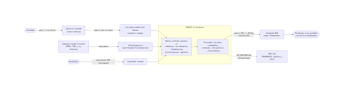
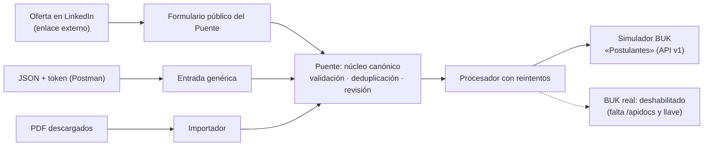

# Puente de postulaciones

**Prototipo académico · Reto #1 SENA · Innovación Abierta 2026-2 (CUEE 2.0, SENA Regional Antioquia) · Entrega del 13/11/2026.**

> **Entorno de simulación.** No hay conexión con LinkedIn ni con BUK, ni compatibilidad comprobada con ellos. El ATS de la demostración es el **Simulador BUK** y la red profesional es el **Simulador LinkedIn**: dos aplicaciones propias. Todos los datos son ficticios (`@demo.test`). La empresa que propuso el reto se llama aquí **«la empresa retadora»** (publicación anonimizada).

## Qué es

Un ***middleware*** (Next.js + PostgreSQL) que **recibe postulaciones y las registra solas en «Postulantes» del proceso correcto del ATS por su API**, sin que el reclutador descargue CV ni vuelva a digitar datos. Valida, normaliza, evita duplicados, verifica la integridad del CV (SHA-256), reintenta y deja trazabilidad de cada paso.

## El problema

Hoy el equipo de selección de la empresa retadora entra a cada vacante de LinkedIn, descarga uno por uno los CV y los vuelve a digitar en su ATS (BUK). Según la ficha del reto, eso retrasa el avance de los candidatos entre 2 y 4 días hábiles y consume horas en tareas repetitivas. La API de reclutamiento de LinkedIn es solo para socios aprobados (verificado en Microsoft Learn) Según la ficha del reto, numeral 2.8, no se conectará la API directa de LinkedIn y las postulaciones se simulan con *payloads* JSON; la integración con BUK sería solo por su API REST, con acceso controlado y guiado por un gestor acompañante. El equipo no tiene una llave de la API de BUK. Detalle: [docs/entrega/02_problema_y_contexto.md](docs/entrega/02_problema_y_contexto.md).

## La solución



*Oferta en LinkedIn con enlace externo → formulario público del Puente → API → Simulador BUK. La entrada JSON (Postman o cualquier fuente con token) y el importador de PDF entran al mismo núcleo.*



## Resultados medidos (local, 11/11/2026, datos ficticios)

| Criterio de éxito | Resultado | Cómo |
|---|---|---|
| Postulaciones registradas sin error en el ATS simulado | **45/45 = 100 %** | Consultando «Postulantes» del Simulador BUK, no la respuesta del Puente; 10 se completaron tras un reintento automático por el límite del ATS (429) |
| Tiempo de registro por candidato | Mediana **1,2 s** (máx. 1,3 s) uno a la vez · **9,6 s** (máx. 10,4 s) con 10 a la vez | Del envío a la creación de la postulación en el ATS |
| Campos mapeados correctamente | **450/450 = 100 %** | 10 campos × 45 postulaciones, incluido el SHA-256 del CV |
| Fallos provocados (token, JSON, PDF falso, > 5 MB, vacante sin vínculo, duplicado, sin autorización…) | **12/12** rechazados, **0** llegaron al ATS | — |
| Pruebas automáticas | 261 Vitest + 67 Playwright en dos vueltas idénticas sin fallos; tras 2 arreglos, 266 + 67 sin fallos | lint, typecheck y build en 0 |

Método, entorno y fallos provocados: [docs/entrega/06_pruebas_y_resultados.md](docs/entrega/06_pruebas_y_resultados.md).

## Qué es real y qué es simulado

| Pieza | Estado |
|---|---|
| **Puente** (`apps/puente`): formulario público, entrada JSON, importador, núcleo, procesador, panel | **Real** (es el producto) |
| **Simulador BUK** (`apps/talentia`): ATS con procesos por etapas y API v1 propia | **Simulado** |
| Adaptador de BUK real (`apps/puente/src/salidas/buk`) | **Deshabilitado**: PENDIENTE llave y `/apidocs` |
| Oferta de LinkedIn con enlace externo | Función estándar de LinkedIn; PENDIENTE verificar la cuenta de la empresa |
| **Simulador LinkedIn** (`apps/vinculo`) con Apply Connect simulado | **Simulado**, extensión fuera de la entrega |
| Bot asistido (`apps/bot-linkedin`) | **Descartado** como vía de entrada (D-75); solo funciona contra el simulador |
| Aviso de privacidad | **Borrador** pendiente de validación legal (Ley 1581 de 2012) |

## Uso de inteligencia artificial (declaración)

**El desarrollo y la redacción de este proyecto se hicieron con apoyo MAYORITARIO de IA generativa.** Claude Code (Anthropic) programó, probó y documentó el sistema siguiendo especificaciones por fases. Claude (chat) apoyó el diseño, la auditoría y la redacción de los prompts. ChatGPT se usó al inicio. El equipo definió el problema, eligió entre alternativas, dirigió cada fase, probó el sistema y tomó las decisiones. No afirmamos que el código se haya revisado línea por línea.

| Qué hizo la IA | Qué hizo el equipo |
|---|---|
| Todo el código, las pruebas automáticas y los scripts (Claude Code) | Definió el problema a partir de la ficha y de la socialización del 15/10 |
| Las especificaciones y los prompts por fase (Claude chat) | Eligió entre alternativas: simular ambos extremos, tres sistemas, V4, descartar el bot, el formulario, los nombres visibles |
| La documentación técnica y de entrega (Claude Code) | Dirigió cada fase (qué prompt y cuándo) y leyó los reportes |
| La ejecución de pruebas, la medición y el despliegue por CLI | Creó el Blueprint de Render, aprobó el despliegue y probó el sistema |

Detalle, evidencia y prompts: [docs/entrega/08_uso_de_ia.md](docs/entrega/08_uso_de_ia.md).

**Contacto con la empresa:** no hubo correos ni mensajes. Lo que se sabe de la empresa viene de la ficha del reto y, para la socialización del 15/10 y el control del 29/10, de lo entendido por el equipo, sin evidencia escrita.

## Probarlo en línea (Render, plan gratuito)

Los servicios se duermen: la primera visita tarda 1–2 minutos.

| Qué | Enlace | Cuenta |
|---|---|---|
| Formulario público de una vacante de prueba | https://puente-postulaciones.onrender.com/postular/cnibi7tmi252 | Sin cuenta |
| Panel del Puente | https://puente-postulaciones.onrender.com | `admin@puente.demo.test` / `Demo2026!` |
| Simulador BUK (proceso 9006) | https://talentia-simulado.onrender.com | `reclutador@andina.demo.test` / `Demo2026!` |
| Estado | https://puente-postulaciones.onrender.com/api/salud · https://talentia-simulado.onrender.com/api/salud | — |

Usa un correo nuevo `@demo.test` y un CV ficticio (`fixtures/cv/*.pdf`). La base gratuita de Render **vence el 28/11/2026**.

## Ejecutarlo en 5 minutos (local)

Requisitos: **Node.js 22+** y **PostgreSQL 16 o 17 instalado** (solo se usan sus programas; el proyecto crea su propio servidor en `.pgdata/`, puerto 5435). En Windows se detecta en `C:\Program Files\PostgreSQL\<versión>\bin`; si no, define `PG_BIN`.

```bash
npm install            # dependencias (versiones exactas)
npm run setup          # .env con secretos aleatorios, PostgreSQL local, migraciones y datos demo
npm run dev            # Puente :3003, Simulador BUK :3002, Simulador LinkedIn :3001
```

En otra terminal, una vez:

```bash
npm run demo:bot       # conecta el Puente con el Simulador BUK (API Key) y deja datos de demostración
```

Luego:

1. **Puente** http://localhost:3003 → `admin@puente.demo.test` / `Demo2026!` → **Formulario público** → «Crear enlace» en un proceso → «Copiar».
2. Abre el enlace en una ventana privada, llena el formulario con datos ficticios y un PDF de `fixtures/cv/` → «Enviar postulación».
3. **Puente → Operaciones**: la postulación pasa a «Completado».
4. **Simulador BUK** http://localhost:3002 → `reclutador@andina.demo.test` → el proceso → columna **«Postulantes»**.
5. Entrada JSON con Postman: [docs/entrega/postman/GUIA.md](docs/entrega/postman/GUIA.md).

Pruebas: `npm run lint` · `npm run typecheck` · `npm test` (Vitest contra PostgreSQL real) · `npm run test:e2e` (build + Playwright). Más comandos y problemas frecuentes: [docs/README_TECNICO.md](docs/README_TECNICO.md).

## Cuentas de demostración (ficticias)

Contraseña de todas: **`Demo2026!`**

| Sistema | Correo | Rol |
|---|---|---|
| Puente | `admin@puente.demo.test` | Administrador (conexiones, fuentes y tokens, enlaces, borrar datos) |
| Puente | `operador@puente.demo.test` | Operador (operaciones, revisión, reintentos, importar) |
| Simulador BUK | `admin@andina.demo.test` | Administradora (API Keys) |
| Simulador BUK | `reclutador@andina.demo.test` | Reclutador |
| Simulador LinkedIn | `reclutadora@andina.demo.test` · `valentina.rios@demo.test` | Reclutadora · candidata (extensión) |

«Andina Software S.A.S.» es una empresa ficticia de los datos de demostración.

## Documentos

Orden de lectura sugerido: [docs/INDICE.md](docs/INDICE.md).

| # | Documento | Contenido |
|---|---|---|
| 01 | [Resumen](docs/entrega/01_resumen.md) | Una página |
| 02 | [Problema y contexto](docs/entrega/02_problema_y_contexto.md) | Dolor, actores, restricciones |
| 03 | [Metodología](docs/entrega/03_metodologia.md) | Design Thinking, Lean Startup, IA; V1 → V4; el bot |
| 04 | [Solución y arquitectura](docs/entrega/04_solucion_y_arquitectura.md) | Real vs. simulado, flujo, capas, diagramas |
| 05 | [Mapeo de datos](docs/entrega/05_mapeo_de_datos.md) | Campo por campo hasta el ATS |
| 06 | [Pruebas y resultados](docs/entrega/06_pruebas_y_resultados.md) | Puerta de calidad ×2, flujo, criterios medidos, Render |
| 07 | [Seguridad y privacidad](docs/entrega/07_seguridad_y_privacidad.md) | Controles, Ley 1581, aviso (borrador) |
| 08 | [Uso de IA](docs/entrega/08_uso_de_ia.md) | Qué hizo la IA, qué decidió el equipo, prompts |
| 09 | [Riesgos y limitaciones](docs/entrega/09_riesgos_y_limitaciones.md) | Matriz y lo que no hace |
| 10 | [Trabajo futuro](docs/entrega/10_trabajo_futuro.md) | BUK real, piloto, legal |
| 11 | [Manual de uso](docs/entrega/11_manual_de_uso.md) | Candidato, reclutador, operador, administrador (con capturas) |
| 12 | [Demo](docs/entrega/12_demo.md) | Guion de 6 minutos y plan B |
| 13 | [Glosario](docs/entrega/13_glosario.md) | Términos del proyecto |
| 14 | [Preguntas de sustentación](docs/entrega/14_preguntas_sustentacion.md) | Respuestas honestas |
| 15 | [Lecciones aprendidas](docs/entrega/15_lecciones_aprendidas.md) | Qué se aprendió y de dónde sale |
| 16 | [Anexo: decisiones](docs/entrega/16_anexo_decisiones.md) | Índice de D-01 a D-77 |
| — | [Guía de ejecución](docs/entrega/GUIA_EJECUCION.md) | Windows (CMD y PowerShell), local y Render, guion de video de 5 minutos |
| — | [Guía de capturas](docs/entrega/GUIA_CAPTURAS.md) | Capturas manuales que debe tomar el equipo |
| — | [Descargables](docs/entrega/descargables/) | Documento completo en .docx y PDF, resumen para el docente, guías en .docx y paquete para Drive |
| — | [Postman](docs/entrega/postman/) | Colección, ejemplos válidos e inválidos, guía de una página |
| — | [Evidencia pendiente](docs/entrega/EVIDENCIA_PENDIENTE.md) | Lo que debe aportar el equipo |
| — | [Decisiones](docs/decisiones.md) | D-01 a D-77 con alternativa descartada y motivo |

## Criterios de evaluación → evidencia

| Criterio (peso) | Dónde está la evidencia |
|---|---|
| **Comprensión del reto** (15 %) | [02](docs/entrega/02_problema_y_contexto.md) (restricciones verificadas con fuente y fecha), [docs/contratos.md](docs/contratos.md), [docs/referencia-ats.md](docs/referencia-ats.md) |
| **Pertinencia de la solución** (25 %) | [04](docs/entrega/04_solucion_y_arquitectura.md), [05](docs/entrega/05_mapeo_de_datos.md), [06 §6.3](docs/entrega/06_pruebas_y_resultados.md) (los tres criterios de éxito medidos), [Postman](docs/entrega/postman/) (postulaciones simuladas en JSON) |
| **Viabilidad y aplicabilidad** (20 %) | Prototipo en Render y en local; `ConectorATS` con BUK listo para implementarse ([10](docs/entrega/10_trabajo_futuro.md)); [09](docs/entrega/09_riesgos_y_limitaciones.md); [docs/despliegue.md](docs/despliegue.md) |
| **Rigor metodológico** (15 %), incluido el uso declarado de IA | [03](docs/entrega/03_metodologia.md), [08](docs/entrega/08_uso_de_ia.md), [docs/decisiones.md](docs/decisiones.md), historial de git, [EVIDENCIA_PENDIENTE](docs/entrega/EVIDENCIA_PENDIENTE.md) |
| **Calidad de la documentación** (10 %) | Este README, [docs/INDICE.md](docs/INDICE.md), [11](docs/entrega/11_manual_de_uso.md), [docs/README_TECNICO.md](docs/README_TECNICO.md), instalación en 5 minutos comprobada desde un clon limpio |
| **Comunicación y sustentación** (15 %) | [12](docs/entrega/12_demo.md) (guion, plan B), [14](docs/entrega/14_preguntas_sustentacion.md) (preguntas), [GUIA_EJECUCION](docs/entrega/GUIA_EJECUCION.md) (video) |

## Pendientes que NO están cumplidos

Llave y API reales de BUK · validación legal del aviso de privacidad · correo de privacidad real · verificación de la cuenta de LinkedIn y oferta publicada con el enlace · capturas manuales ([guía](docs/entrega/GUIA_CAPTURAS.md)) · límite por IP en Render (encabezado confiable) · evidencia del equipo para la metodología ([lista](docs/entrega/EVIDENCIA_PENDIENTE.md)).
