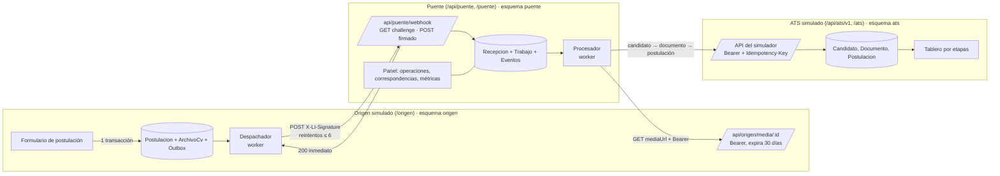
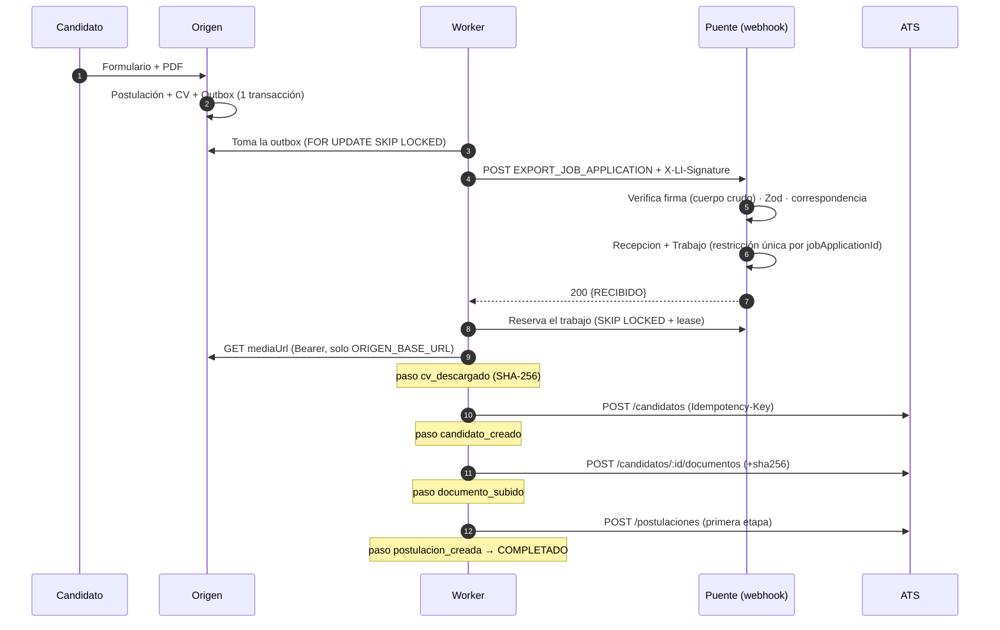
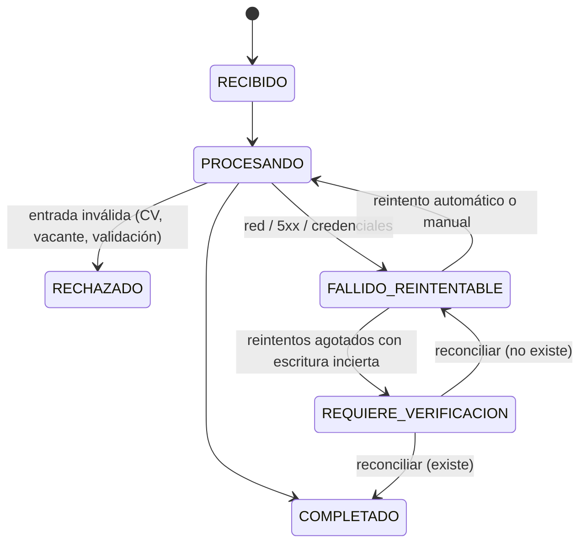

# Arquitectura

> Creado por Claude Code (2026-10-25).

## Componentes



- **Una app Next.js 16** (App Router) sirve los tres módulos. **Un worker** (`worker/index.ts`) ejecuta el despachador del origen y el procesador del puente. **PostgreSQL** tiene un esquema por sistema (D-02).
- **Los sistemas solo se hablan por HTTP**, aunque compartan proceso y base. El puente nunca lee tablas del origen ni del ATS.

## Recorrido de una postulación



## Garantías

| Riesgo | Mecanismo | Dónde |
|---|---|---|
| Perder una postulación si el envío falla | Outbox transaccional en el origen y reintentos con backoff | `src/modules/origen/` |
| Entregas falsas | HMAC-SHA256 sobre el cuerpo crudo, comparación en tiempo constante | `src/lib/firma.ts` |
| Duplicados por reenvío o concurrencia | `UNIQUE(jobApplicationId)`, `UNIQUE(recepcionId)` en el trabajo; respuesta 200 DUPLICADO | `src/modules/puente/webhook.ts` |
| Dos workers con el mismo trabajo | `FOR UPDATE SKIP LOCKED` + lease | `reclamarTrabajos` |
| Caída a mitad del recorrido | Pasos confirmados; al vencer el lease, otro worker retoma | `procesador.ts` |
| Escritura repetida en el ATS | Idempotency-Key por paso; candidato único por correo | ATS simulado |
| Respuesta perdida tras escribir | Consulta por referencia externa antes de reescribir → REQUIERE_VERIFICACION si no se puede saber | `procesador.ts`, `operaciones.ts` |
| SSRF por `mediaUrl` | Solo `ORIGEN_BASE_URL/api/origen/media/`, sin seguir redirecciones, con límite de tamaño | `descargarCv` |
| CV corrupto | Verificación `%PDF-`, tamaño y SHA-256 extremo a extremo (el ATS lo recalcula) | puente y ATS |
| Panel expuesto en un entorno real | Autenticación de demo solo con host local; si no se cumple, el panel queda cerrado | `src/lib/sesion.ts` |

Lease y tiempos: lease 60 s ≥ descarga (15 s) + 3 llamadas al ATS (10 s cada una). Ver D-14.

## Estados del puente



## Estructura del código

```
src/app/            UI y route handlers (origen/, puente/, ats/, ingresar/, api/…)
src/modules/        origen/ (postulación, vacantes, despachador) · puente/ (webhook, procesador, operaciones,
                    cliente ATS, mensajes) · ats/ (servicio, fallos) · contrato-apply-connect.ts
src/lib/            config, db, firma, sesión, archivos, privacidad, fechas
worker/             proceso del worker
prisma/             esquema (3 esquemas), migraciones, datos de demo
tests/  e2e/        Vitest (PostgreSQL real) · Playwright (app + worker reales vía supervisor)
```
