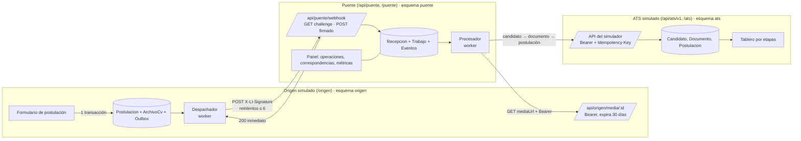
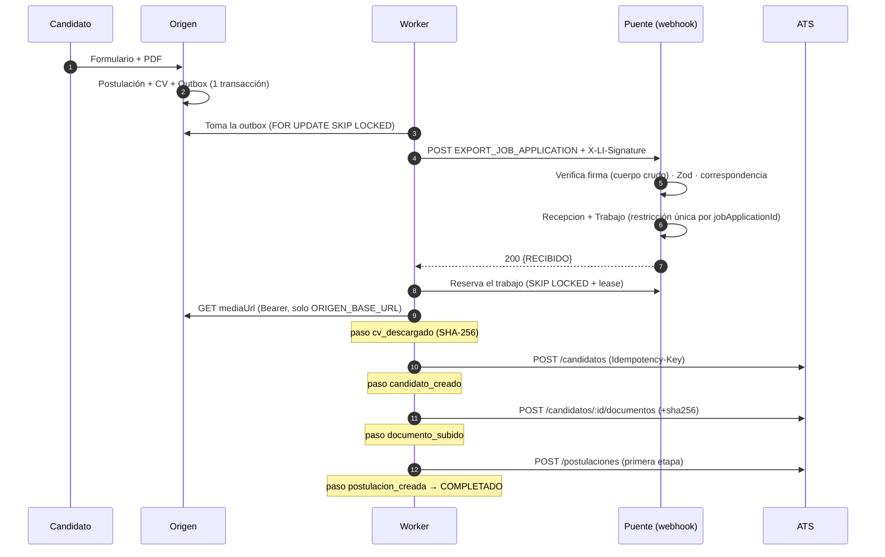
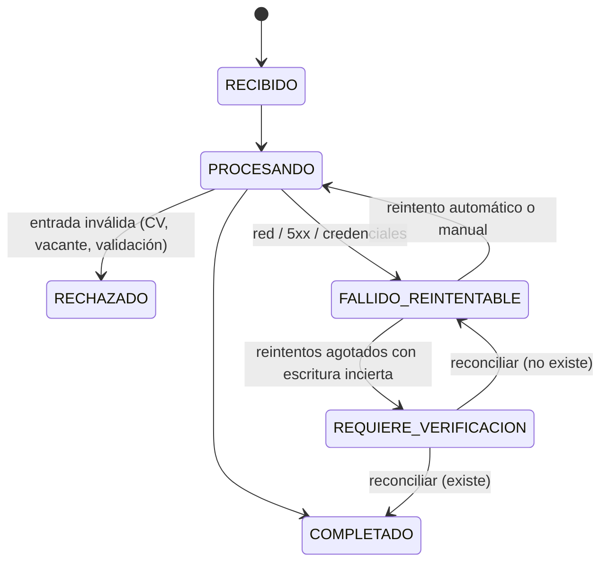
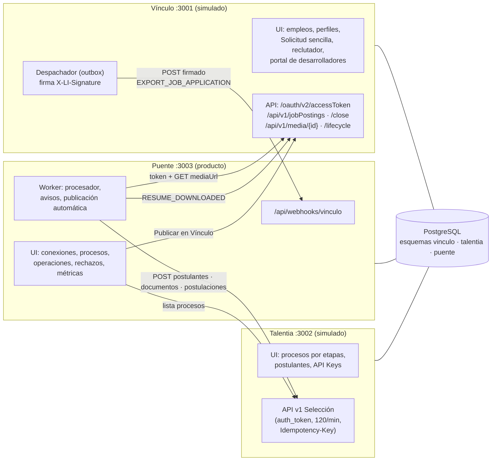
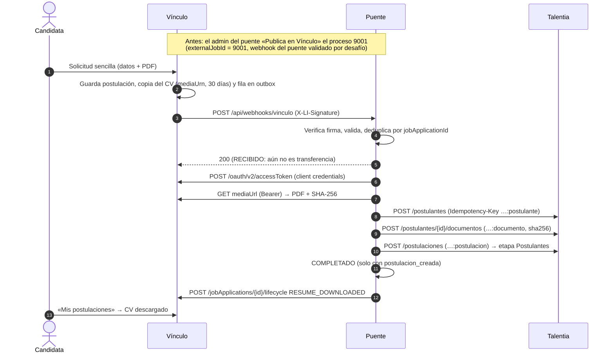
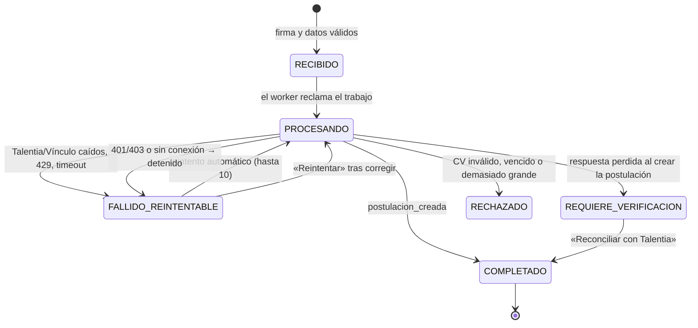
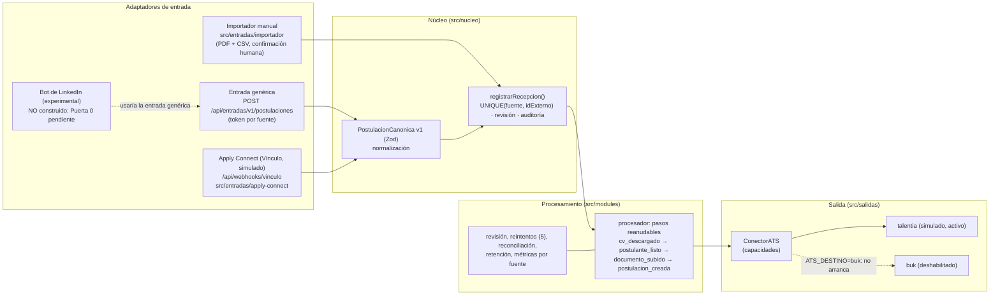
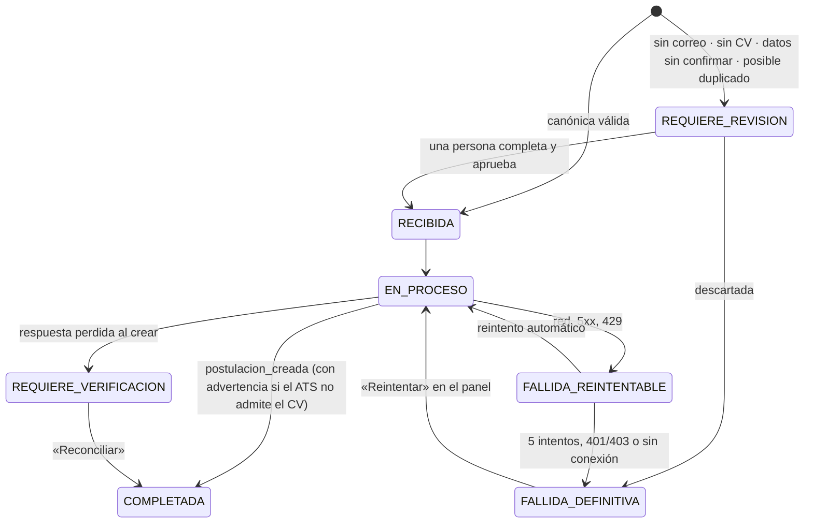

# Arquitectura

> Creado por Claude Code (2026-10-25).

## Componentes



- **Una app Next.js 16** (App Router) sirve los tres módulos. **Un worker** (`worker/index.ts`) ejecuta el despachador del origen y el procesador del puente. **PostgreSQL** tiene un esquema por sistema (D-02).
- **Los sistemas solo se hablan por HTTP**, aunque compartan proceso y base. El puente nunca lee tablas del origen ni del ATS.

## Recorrido de una postulación



## Garantías

| Riesgo | Mecanismo | Dónde |
|---|---|---|
| Perder una postulación si el envío falla | Outbox transaccional en el origen y reintentos con backoff | `src/modules/origen/` |
| Entregas falsas | HMAC-SHA256 sobre el cuerpo crudo, comparación en tiempo constante | `src/lib/firma.ts` |
| Duplicados por reenvío o concurrencia | `UNIQUE(jobApplicationId)`, `UNIQUE(recepcionId)` en el trabajo; respuesta 200 DUPLICADO | `src/modules/puente/webhook.ts` |
| Dos workers con el mismo trabajo | `FOR UPDATE SKIP LOCKED` + lease | `reclamarTrabajos` |
| Caída a mitad del recorrido | Pasos confirmados; al vencer el lease, otro worker retoma | `procesador.ts` |
| Escritura repetida en el ATS | Idempotency-Key por paso; candidato único por correo | ATS simulado |
| Respuesta perdida tras escribir | Consulta por referencia externa antes de reescribir → REQUIERE_VERIFICACION si no se puede saber | `procesador.ts`, `operaciones.ts` |
| SSRF por `mediaUrl` | Solo `ORIGEN_BASE_URL/api/origen/media/`, sin seguir redirecciones, con límite de tamaño | `descargarCv` |
| CV corrupto | Verificación `%PDF-`, tamaño y SHA-256 extremo a extremo (el ATS lo recalcula) | puente y ATS |
| Panel expuesto en un entorno real | Autenticación de demo solo con host local; si no se cumple, el panel queda cerrado | `src/lib/sesion.ts` |

Lease y tiempos: lease 60 s ≥ descarga (15 s) + 3 llamadas al ATS (10 s cada una). Ver D-14.

## Estados del puente



## Estructura del código

```
src/app/            UI y route handlers (origen/, puente/, ats/, ingresar/, api/…)
src/modules/        origen/ (postulación, vacantes, despachador) · puente/ (webhook, procesador, operaciones,
                    cliente ATS, mensajes) · ats/ (servicio, fallos) · contrato-apply-connect.ts
src/lib/            config, db, firma, sesión, archivos, privacidad, fechas
worker/             proceso del worker
prisma/             esquema (3 esquemas), migraciones, datos de demo
tests/  e2e/        Vitest (PostgreSQL real) · Playwright (app + worker reales vía supervisor)
```

---

## v2 · Tres sistemas independientes

> Actualizado por Claude Code (2026-10-29). Las secciones anteriores describen la v1 (una sola app con `/origen`, `/puente` y `/ats`); esta sección describe lo construido en la v2.

### Componentes



- **Fronteras:** cada app tiene su `package.json`, su `.env`, su esquema y su autenticación (Better Auth con cookie propia: `vin_sesion`, `tal_sesion`, `pue_sesion`). No se importa código de dominio entre apps (D-20 a D-22); el puente solo conoce a los otros dos por sus URL y credenciales guardadas en «Conexiones» (D-41).
- **Workers:** en local y en Render corren dentro del proceso web (`WORKER_EN_PROCESO=1`, `instrumentation.ts`); en las pruebas E2E corren como procesos aparte para poder matarlos.

### Secuencia: de la «Solicitud sencilla» a Postulantes



### Estados de una recepción en el puente



Las entregas inválidas en la entrada (firma, datos incompletos, mediaUrl no autorizada, vacante cerrada o sin proceso) no crean recepción: responden 4xx con el código de Apply Connect, quedan en `EntregaRechazada` (pantalla «Rechazos») y no escriben nada en Talentia.

Pasos dentro de PROCESANDO, cada uno guardado y con su Idempotency-Key: `cv_descargado → postulante_listo → documento_subido → postulacion_creada`. Una caída a mitad retoma desde el último paso guardado. El aviso `RESUME_DOWNLOADED` tiene su propio estado (`PENDIENTE → ENVIADO | FALLIDO`) y no altera el COMPLETADO (D-47).

### Estructura del código (v2)

```
apps/
  vinculo/   src/app (UI y API) · src/modules (vacantes, postulacion, despachador, aplicaciones, api/) · prisma/ · worker/ · tests/
  talentia/  src/app (UI, /api/v1, /apidocs) · src/modules (seleccion, etapas, procesos, api/) · prisma/ · tests/
  puente/    src/app (UI, /api/webhooks/vinculo) · src/modules (conexiones, webhook, procesador, avisos, publicacion,
             vinculo-cliente, ats-cliente, destino) · prisma/ · worker/ · tests/ (dobles de contrato)
e2e/         Playwright con los tres sistemas reales (supervisor.mjs los arranca y los mata)
scripts/     setup, PostgreSQL local, dev, demo:conectar
```

---

## V4 · Capas: el Puente independiente de la fuente y del ATS

> Actualizado por Claude Code (2026-11-02). Especificación: `docs/v4/ESPECIFICACION_V4.md` §5–§9. Ubicación real en el código: D-53.



| Capa | Responsabilidad | No hace | Dónde |
|---|---|---|---|
| Adaptadores de entrada | Obtener la postulación en su origen y convertirla a la canónica; la fuente la fija el adaptador o el token | Deduplicar, decidir revisiones, hablar con el ATS | `src/entradas/*`, `src/modules/webhook.ts` |
| Núcleo | Validar el contrato, normalizar, deduplicar, decidir revisión, guardar y encolar | Saber de qué sitio vino | `src/nucleo/*` |
| Procesamiento | Pasos con reintentos, revisión humana, reconciliación, retención, auditoría, métricas | Conocer rutas del ATS | `src/modules/{procesador,revision,retencion,operaciones}.ts` |
| Salida | Traducir los pasos a la API de cada ATS | Decidir reintentos o estados | `src/salidas/*` |

**Estados V4** (visibles; derivados de los guardados, D-52): `RECIBIDA`, `REQUIERE_REVISION`, `EN_PROCESO`, `COMPLETADA`, `FALLIDA_REINTENTABLE`, `FALLIDA_DEFINITIVA` (más `REQUIERE_VERIFICACION` de la v2: respuesta perdida del ATS). `DUPLICADA` es una respuesta, no una fila.


