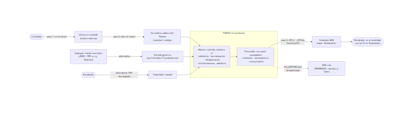
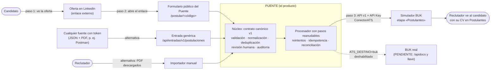
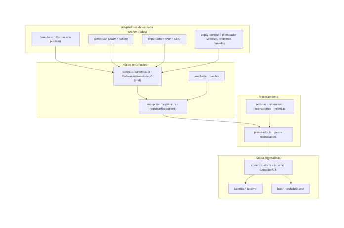
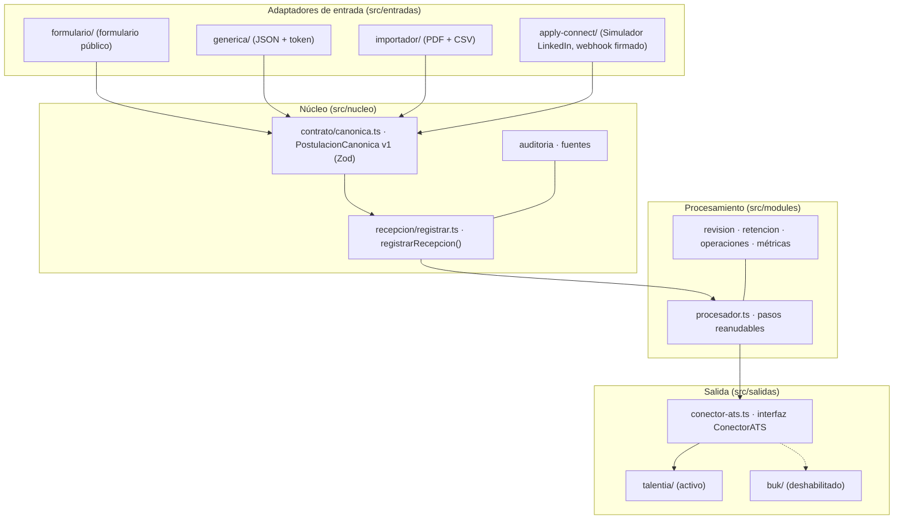
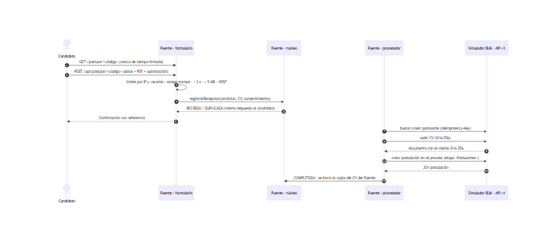
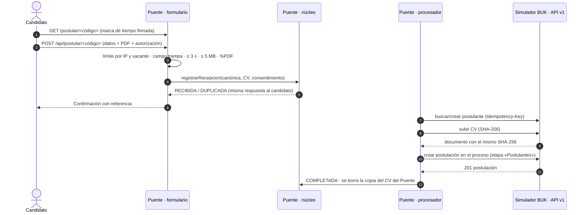
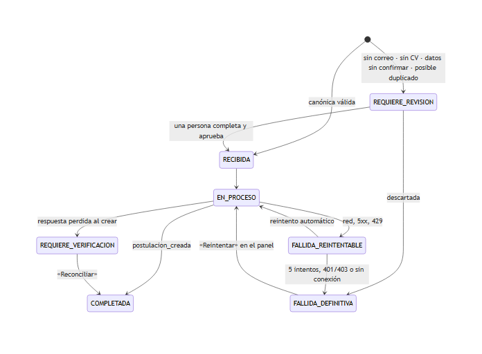
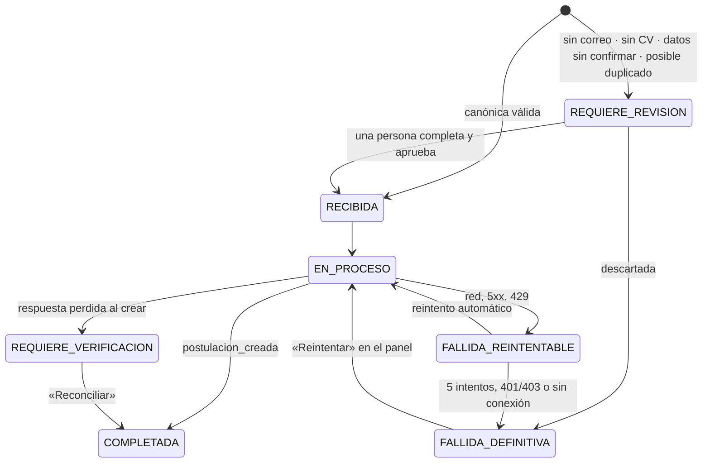

# 4. Solución y arquitectura

> Lo que se entrega es **el Puente**: un middleware que recibe postulaciones (simuladas) y las registra en «Postulantes» del proceso correcto del ATS por su API. El origen (LinkedIn) y el ATS (BUK) **no** están conectados: en la demo los reemplazan el **Simulador LinkedIn** y el **Simulador BUK**, dos aplicaciones propias.

## 4.1 Qué es real y qué es simulado

| Pieza | Estado | Comentario |
|---|---|---|
| **Puente** (`apps/puente`) | **Real** (es el producto) | Next.js 16, PostgreSQL, worker con reintentos, panel con roles |
| Formulario público `/postular/<código>` | **Real** (parte del Puente) | Lo abre el candidato desde el enlace externo de la oferta |
| Entrada genérica `POST /api/entradas/v1/postulaciones` | **Real** (parte del Puente) | Contrato propio (Decisión interna), token por fuente |
| Importador manual de PDF | **Real** (parte del Puente) | Alternativa legal cuando hay CV descargados |
| Oferta en LinkedIn con enlace externo | **Real: publicada** por el equipo con el enlace externo al formulario del Puente | Pueden llegar datos reales: ver [07](07_seguridad_y_privacidad.md) §7.0 |
| ATS de la demo: **Simulador BUK** (`apps/talentia`) | **Simulado** | Reproduce la estructura del ATS observado y una API v1 propia («contrato del simulador») |
| Adaptador BUK real (`src/salidas/buk/index.ts`) | **Deshabilitado** | Sin rutas ni encabezados: falta su `/apidocs` y la llave. **PENDIENTE: llave y API reales de BUK** |
| **Simulador LinkedIn** (`apps/vinculo`) | **Simulado**, fuera de esta entrega | Red profesional con «Solicitud sencilla» y API modelada sobre Apply Connect (apagada por defecto, D-68). Demuestra la «vía oficial futura» |
| Bot asistido (`apps/bot-linkedin`) | **Descartado** como vía de entrada (D-75) | Solo funciona contra el simulador; el perfil LinkedIn se niega a correr |

## 4.2 Flujo final

*Figura 4.1. Flujo final de una postulación (exportado de Mermaid).*

1. El candidato ve la oferta en LinkedIn. La oferta lleva un **enlace externo** (no se usa «Solicitud sencilla» ni ninguna API de LinkedIn).
2. El enlace abre el **formulario público del Puente** de esa vacante: nombres, apellidos, correo, teléfono con indicativo, ciudad, perfil de LinkedIn (opcional), CV en PDF y la autorización de datos (aviso de privacidad en `/privacidad`).
3. El Puente valida, normaliza, guarda la prueba del consentimiento, evita duplicados y encola.
4. El procesador registra al candidato en el ATS **por API**: crea o actualiza el postulante, sube el CV (el ATS confirma el mismo SHA-256) y crea la postulación en la etapa «Postulantes» del proceso vinculado.
5. El reclutador ve al candidato en el ATS, sin haber descargado ni digitado nada. El operador ve cada paso en «Operaciones».

Las otras entradas (JSON con token e importador) entran al **mismo núcleo** y siguen el mismo camino. Por eso el alcance pedido por la ficha (*middleware* que recibe postulaciones simuladas en JSON y las registra por API) se cumple con cualquiera de ellas.

## 4.3 Capas

*Figura 4.2. Capas del Puente (exportado de Mermaid).*

| Capa | Responsabilidad | No hace |
|---|---|---|
| Entrada | Convertir lo que llega (formulario, JSON, PDF, webhook) a la postulación canónica | Deduplicar, hablar con el ATS |
| Núcleo | Validar, normalizar (correo en minúsculas, teléfono E.164, nombres sin espacios sobrantes), deduplicar por `(fuente, idExterno)`, decidir revisión humana, auditar, encolar | Saber de qué sitio vino |
| Procesamiento | Ejecutar los pasos `cv_descargado → postulante_listo → documento_subido → postulacion_creada` con reintentos (5), reconciliación y retención | Conocer rutas del ATS |
| Salida | Traducir cada paso a la API del ATS (`ConectorATS`) | Decidir reintentos o estados |

Cambiar de fuente o de ATS no toca el núcleo: para BUK real basta implementar `src/salidas/buk/index.ts` con su documentación y poner `ATS_DESTINO=buk`.

## 4.4 Secuencia de una postulación por el formulario

*Figura 4.3. Secuencia del formulario al ATS (exportado de Mermaid).*

## 4.5 Estados de una recepción

*Figura 4.5. Estados de una recepción (exportado de Mermaid).*

**Regla:** un acuse 202 no es una transferencia. Solo `postulacion_creada` en el ATS cuenta como registrada (por eso la medición de [06](06_pruebas_y_resultados.md) consulta el ATS, no la respuesta del Puente).

## 4.6 Despliegue

| Sistema | Local | Render (plan gratuito) |
|---|---|---|
| Puente | http://localhost:3003 | https://puente-postulaciones.onrender.com (rama `v4`) |
| Simulador BUK | http://localhost:3002 | https://talentia-simulado.onrender.com (rama `v4`) |
| Simulador LinkedIn | http://localhost:3001 | https://vinculo-simulado.onrender.com (rama `v2`, fuera de esta entrega) |
| Base | PostgreSQL local (`.pgdata`, puerto 5435), un esquema por app | PostgreSQL gratuito, **vence el 28/11/2026** |

Los servicios gratuitos se duermen tras unos 15 minutos y tardan 1–2 minutos en despertar. Detalle: [docs/despliegue.md](../despliegue.md).

## 4.7 Tecnología

Next.js 16.4.3 · React 19.3.1 · TypeScript 5.9.3 · Prisma 7.10.1 + PostgreSQL · Better Auth 1.7.10 · Zod 4 · unpdf 1.9.0 (texto de PDF, sin IA) · Vitest 5.0.5 · Playwright 1.64.1 + axe-core · npm workspaces · Render. Versiones exactas en cada `package.json`.

## 4.8 Más detalle

- [docs/arquitectura.md](../arquitectura.md): historia de la arquitectura (V1, V2, V4) y estructura del código.
- [docs/contratos.md](../contratos.md): contratos verificados y contratos del simulador, cada punto etiquetado.
- [05_mapeo_de_datos.md](05_mapeo_de_datos.md): campo por campo.
