# 11. Manual de uso (flujo final)

> Cuatro roles: candidato, reclutador, operador y administrador. Todo es **simulado** y con datos ficticios; contraseña de las cuentas demo: `Demo2026!`. Las capturas se tomaron el 11/11/2026 con Playwright sobre la versión local (`scripts/capturas-entrega.mjs`).
> Manuales anteriores por rol (Apply Connect, importador, bot): [docs/manuales/](../manuales/).

| Rol | Dónde | Cuenta demo |
|---|---|---|
| Candidato | Enlace público de la vacante (`/postular/<código>`), sin cuenta | — |
| Reclutador | Simulador BUK (:3002 / talentia-simulado.onrender.com) | `reclutador@andina.demo.test` |
| Operador | Puente (:3003 / puente-postulaciones.onrender.com) | `operador@puente.demo.test` |
| Administrador | Puente | `admin@puente.demo.test` |

## 11.1 Candidato

1. En la oferta de LinkedIn, pulsa el botón de postulación: abre el **formulario público** de la vacante (no necesitas cuenta).
2. Lee la ficha de la vacante (cargo, ciudad, modalidad, tipo de empleo, descripción).
3. Llena **Nombres, Apellidos, Correo, Indicativo y Teléfono, Ciudad de residencia**; el **Perfil de LinkedIn** es opcional.
4. Adjunta tu **hoja de vida en PDF** (máximo 5 MB).
5. Lee el **aviso de privacidad** (enlace en el formulario) y marca la autorización. Sin ella no se puede enviar.
6. Pulsa **«Enviar postulación»**. Verás la confirmación con tu **número de referencia** y qué pasa después.

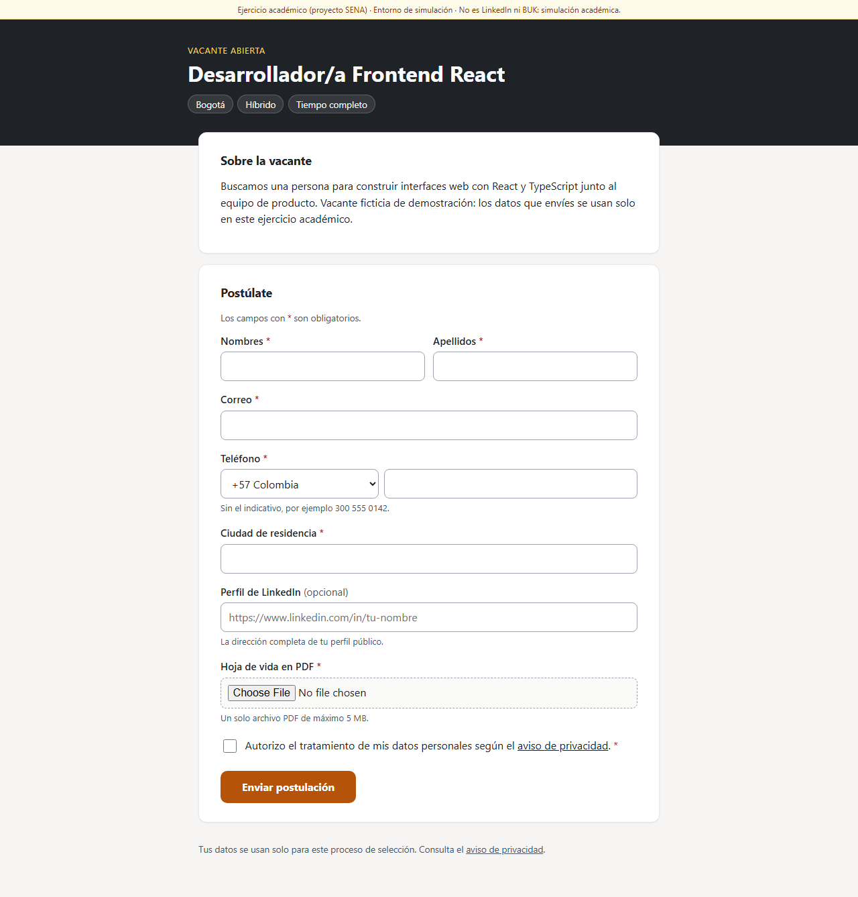

*Figura 11.1. Formulario público de una vacante (escritorio).*

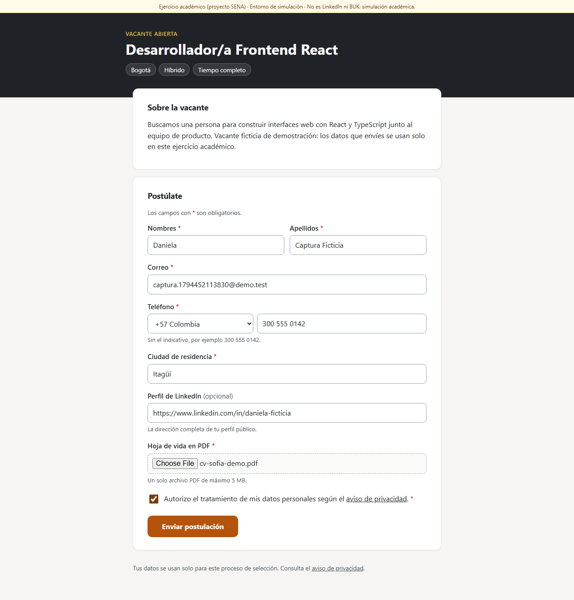

*Figura 11.2. Formulario lleno con datos ficticios, listo para enviar.*

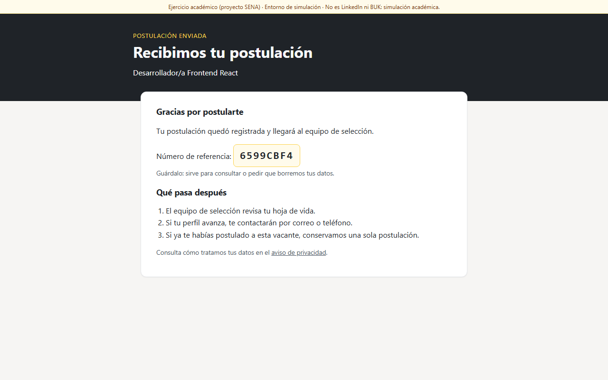

*Figura 11.3. Confirmación con el número de referencia.*

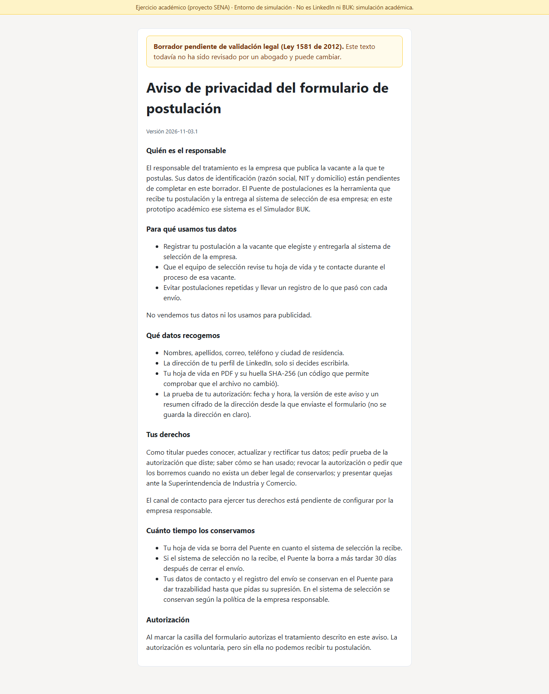

*Figura 11.4. Aviso de privacidad (borrador pendiente de validación legal).*

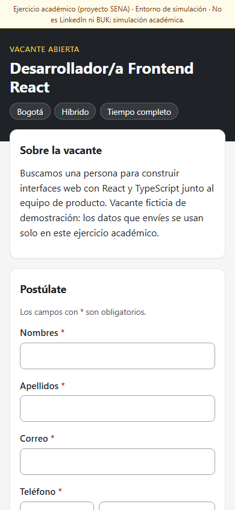

*Figura 11.5. El formulario en un teléfono.*

**Mensajes comunes:** «Escribe un correo válido…» (revisa el formato), «El archivo no es un PDF válido…» (adjunta un PDF real), «El archivo supera el máximo de 5 MB», «Recibimos demasiados envíos desde tu conexión…» (espera unos minutos), «El formulario se envió demasiado rápido…» (revisa y vuelve a enviar), «Esta vacante ya no recibe postulaciones» (el enlace se desactivó). Si envías dos veces con el mismo correo, ves la misma referencia: es la misma postulación.

## 11.2 Reclutador (Simulador BUK)

1. Ingresa al Simulador BUK → **Selección → Procesos** → abre el proceso.
2. Las postulaciones llegan solas a la columna **«Postulantes»**, «Sin calificar», con la fuente «Formulario público» (o «Importador manual», o el nombre de la fuente JSON).
3. Abre la tarjeta: datos de contacto, referencia externa (perfil de LinkedIn si lo dio) y el **CV** para descargar. Desde aquí el proceso sigue como siempre (mover de etapa, descartar).

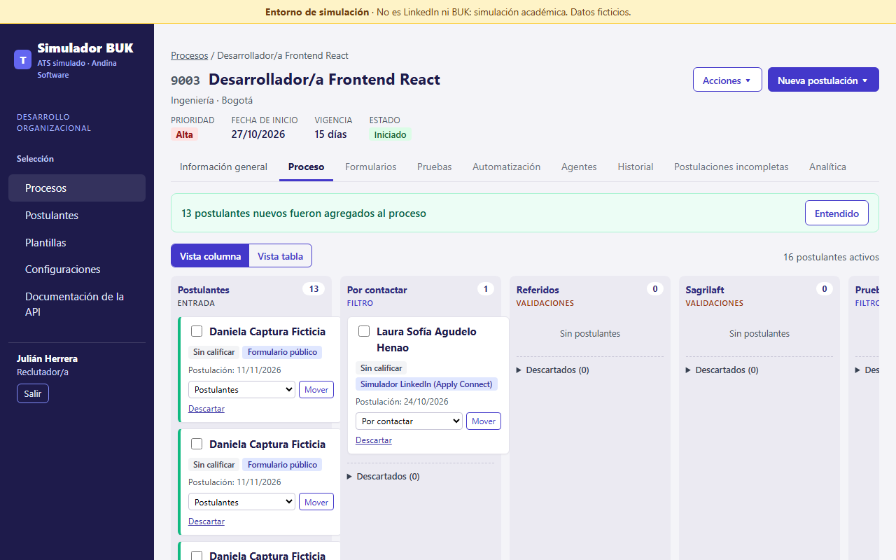

*Figura 11.6. Tablero del proceso en el Simulador BUK: la postulación llegó a «Postulantes».*

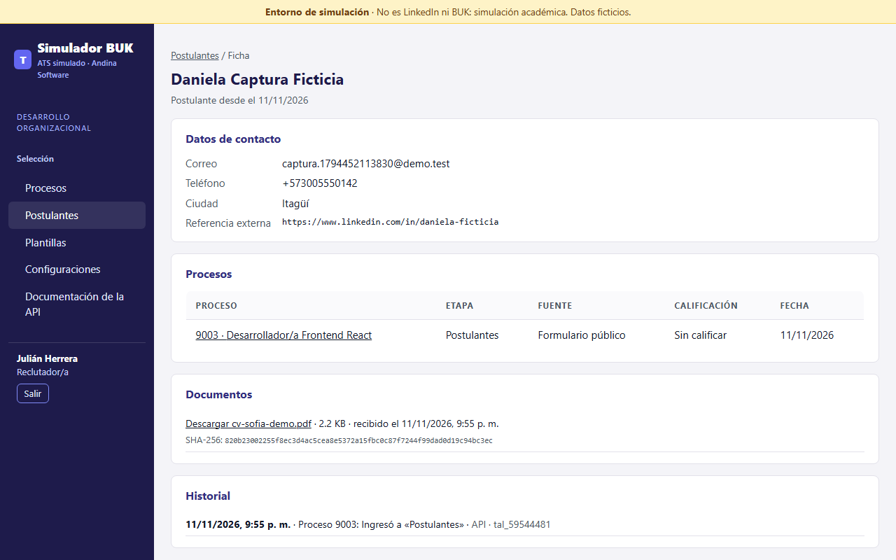

*Figura 11.7. Ficha del postulante con su CV.*

Una misma persona en dos procesos es **un** postulante con **dos** postulaciones. El reclutador no descarga ni digita nada.

## 11.3 Operador (Puente)

1. **Operaciones**: cada postulación con su fuente y estado. **Recibido no es transferido**: solo «Completado» significa que ya está en el ATS.
2. Abre una operación para ver la línea de tiempo: `cv_descargado → postulante_listo → documento_subido → postulacion_creada`, con cada intento.
3. **Requiere revisión** (sin correo, sin CV, datos sin confirmar o posible duplicado): completa los datos y **Aprueba**, o **Descarta**.
4. **Fallido**: el Puente reintenta solo (hasta 5 veces); si se detuvo, corrige la causa y pulsa **«Reintentar»** (continúa desde el último paso, sin duplicar). **Requiere verificación**: «Reconciliar».
5. **Importar** (alternativa): elige el proceso, adjunta PDF descargados, revisa los datos sugeridos y **Confirma**. Manual: [docs/manuales/importador.md](../manuales/importador.md).
6. **Métricas**: recibidas, completadas, en revisión, duplicados evitados y tiempos, por fuente.

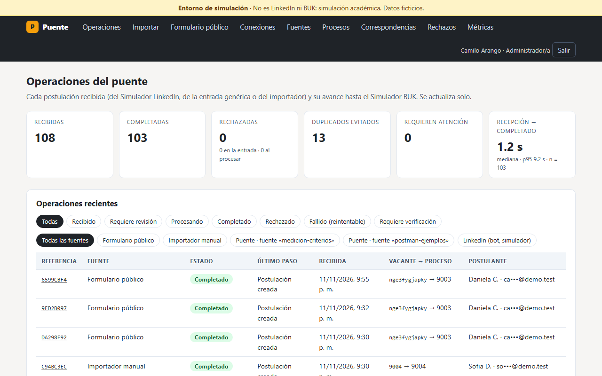

*Figura 11.8. Operaciones: la postulación del formulario aparece con su estado.*

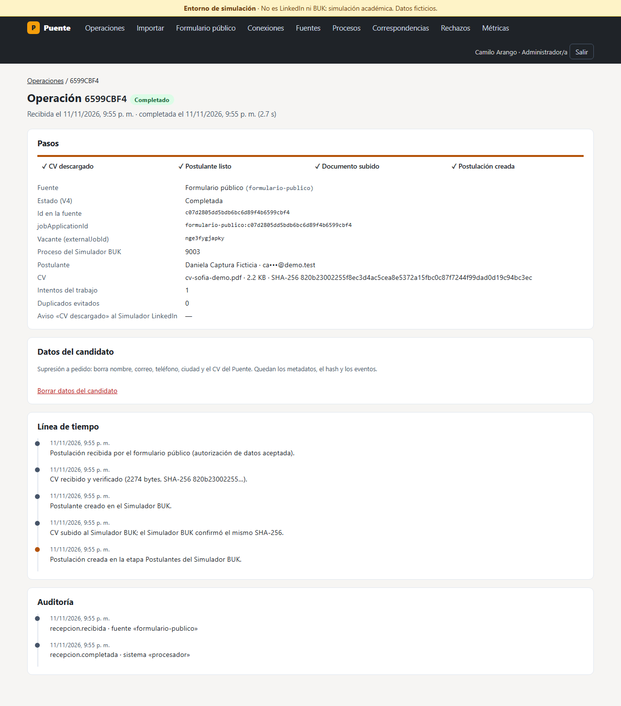

*Figura 11.9. Detalle de una operación con sus pasos.*

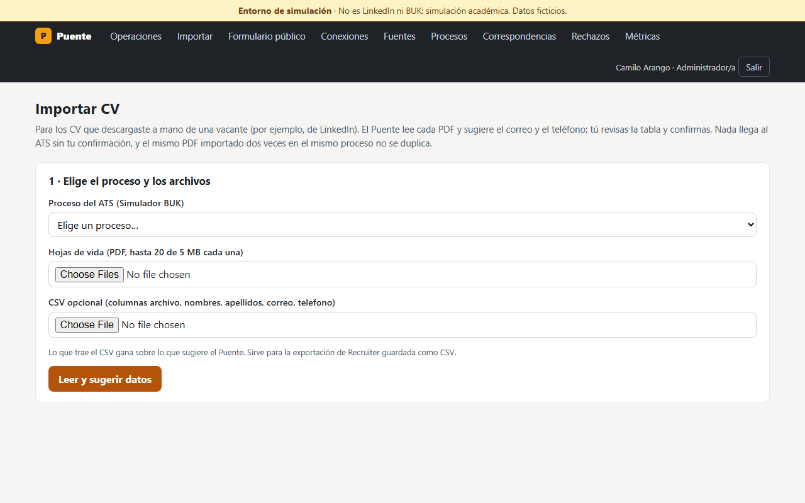

*Figura 11.10. Importador manual (alternativa con PDF descargados).*

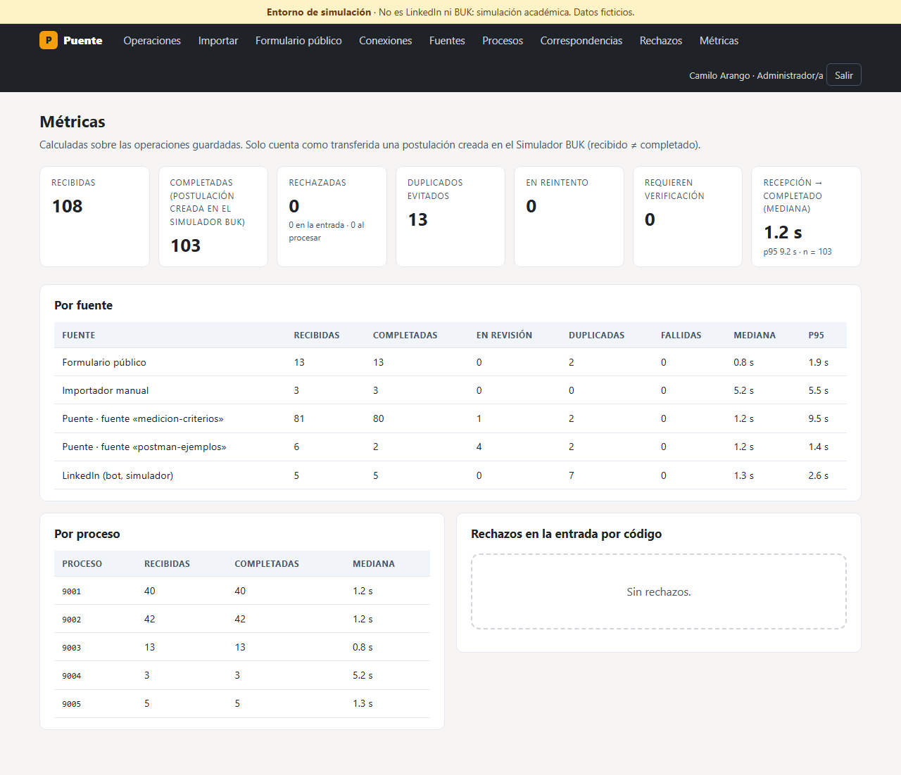

*Figura 11.11. Métricas por fuente.*

## 11.4 Administrador (Puente)

Todo lo del operador, más:

1. **Conexiones**: URL del Simulador BUK y su API Key (Lectura y Modificación) → «Guardar y probar». La llave se guarda cifrada y solo se ve `••••` + 4 caracteres.
2. **Formulario público**: lista los procesos del ATS. **«Crear enlace»** genera el enlace de la vacante; **«Copiar»** lo copia para pegarlo como **enlace externo** de la oferta en LinkedIn. En «Lo que ve el candidato» se edita la ficha pública (no cambia el proceso del ATS). **«Desactivar»** deja de recibir.
3. **Fuentes** (entrada JSON): crea una fuente y **Genera su token** (se ve una sola vez); **Revocar** lo invalida. Guía de envío: [postman/GUIA.md](postman/GUIA.md).
4. **Correspondencias**: vincula la vacante de cada fuente a un proceso del ATS.
5. **Borrar datos del candidato** (en el detalle de una operación): borra nombre, correo, teléfono, ciudad y CV del Puente; queda el hash y el evento auditado.
6. En Render: `PRIVACIDAD_CORREO` (correo de privacidad real, **PENDIENTE**), `ATS_DESTINO=talentia`, `RETENCION_CV_DIAS=30`, `PUENTE_MAX_INTENTOS=5`.

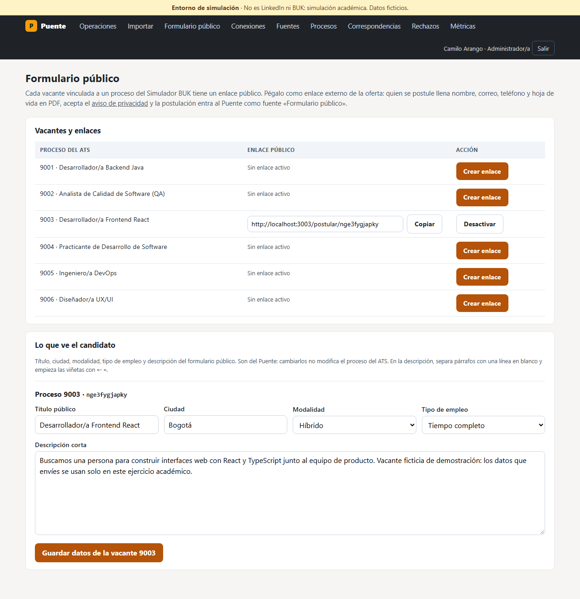

*Figura 11.12. Panel «Formulario público»: enlace de cada vacante con «Copiar».*

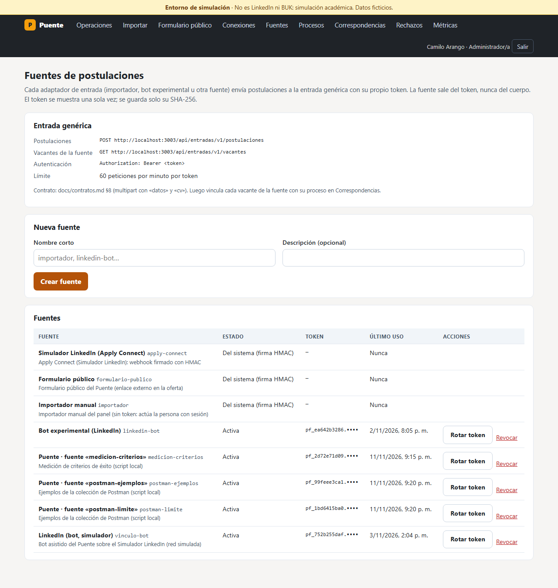

*Figura 11.13. Fuentes con token para la entrada JSON.*

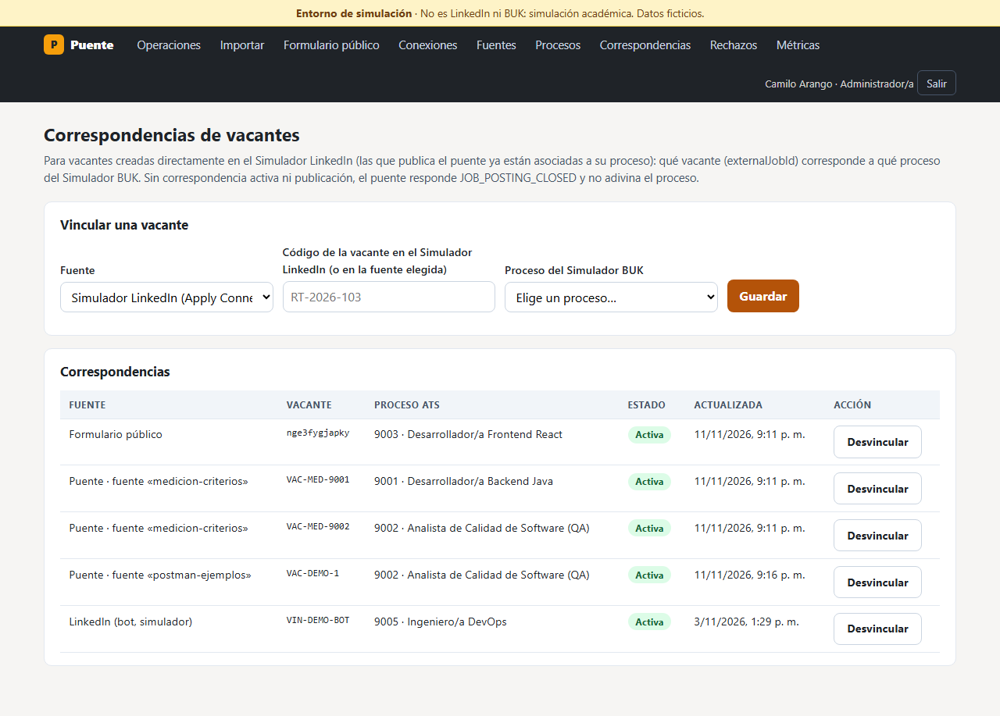

*Figura 11.14. Correspondencias fuente/vacante → proceso del ATS.*

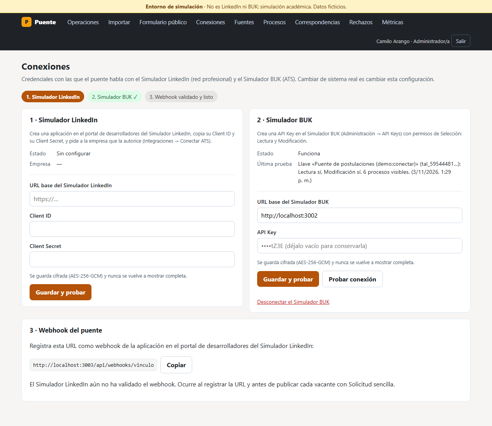

*Figura 11.15. Conexión con el Simulador BUK.*

## 11.5 Integrador (API)

- Entrada del Puente: [postman/GUIA.md](postman/GUIA.md) y [docs/contratos.md §8](../contratos.md).
- API del Simulador BUK (lo que usa el Puente por dentro): `/apidocs` del Simulador BUK. Es un **contrato del simulador**, no la API de BUK.

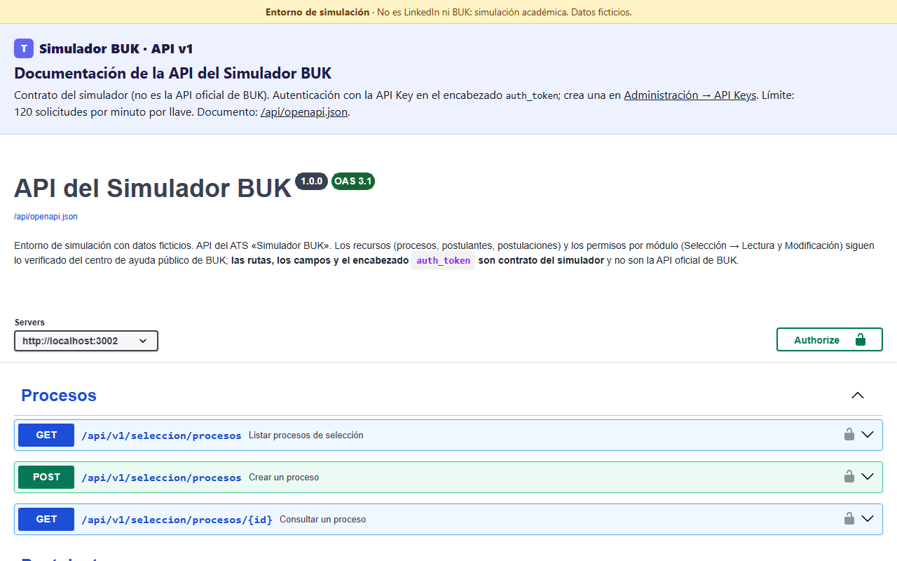

*Figura 11.16. Documentación de la API v1 del Simulador BUK (`/apidocs`).*
