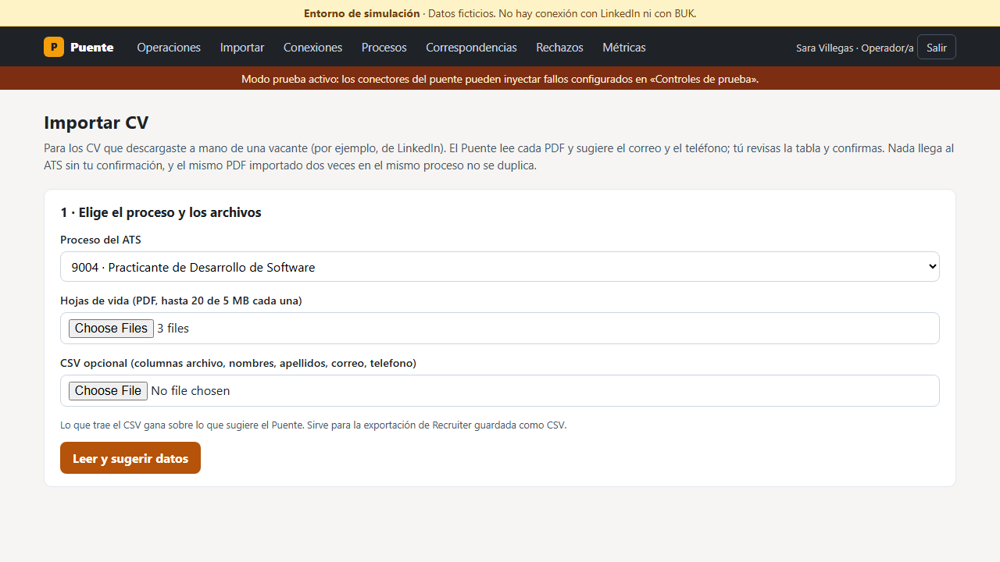
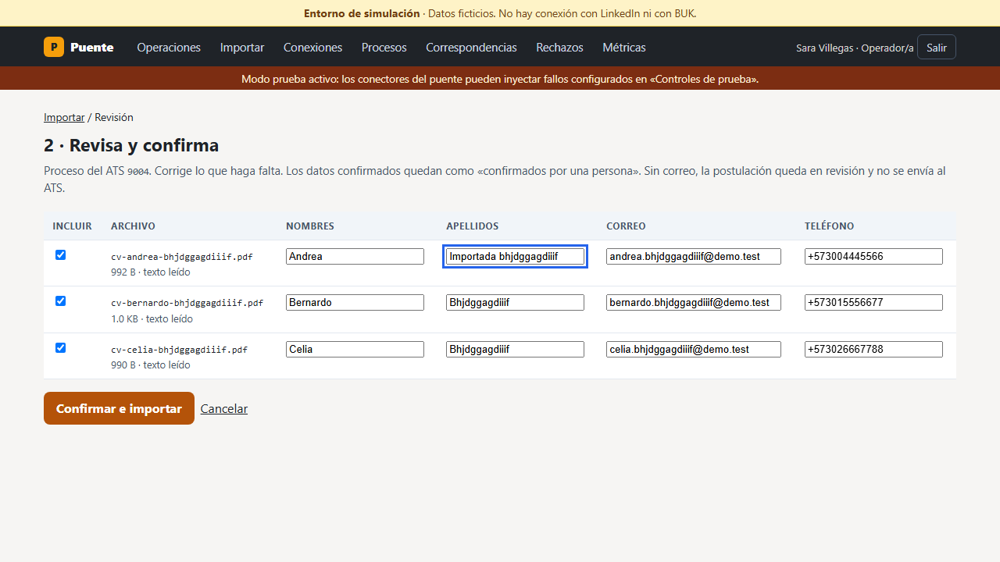
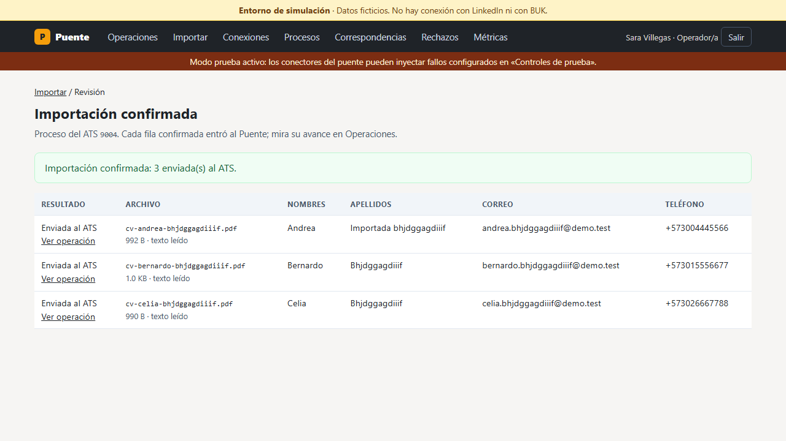
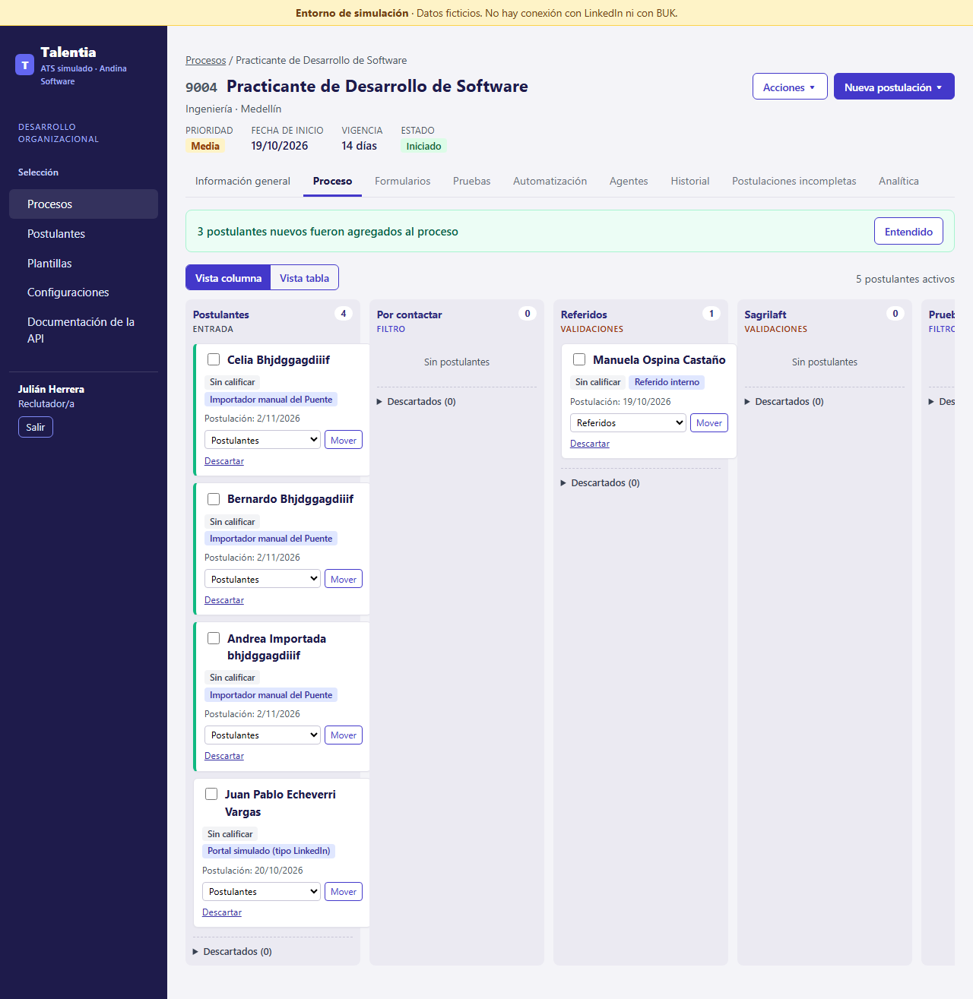

# Manual · Importador de CV (Puente)

> Actualizado por Claude Code (2026-11-02, V4 F3). Para el reclutador o reclutadora que hoy descarga los CV de una vacante (por ejemplo, de LinkedIn) y los vuelve a digitar en el ATS. **Talentia es un ATS simulado**; los datos de las capturas son ficticios.

El importador elimina la digitación: tú arrastras los PDF, el Puente sugiere los datos y tú los confirmas. Nada llega al ATS sin tu confirmación.

## Antes de empezar

- Una cuenta del Puente (administrador u operador). Demo: `operador@puente.demo.test` / `Demo2026!`.
- La conexión con el ATS configurada (Puente → Conexiones).
- Los CV en PDF (hasta 20 por vez, 5 MB cada uno). Opcional: un CSV con columnas `archivo, nombres, apellidos, correo, telefono` (por ejemplo, la exportación de Recruiter guardada como CSV; no se acepta XLSX).

## Pasos

1. **Puente → Importar.** Elige el **proceso del ATS** (o una correspondencia vacante → proceso), adjunta los PDF y, si lo tienes, el CSV. Pulsa **«Leer y sugerir datos»**.

   

2. **Revisa la tabla.** Para cada PDF el Puente sugiere:
   - **Correo y teléfono:** los busca en el texto del PDF (sin inteligencia artificial). El teléfono queda en formato internacional (+57 si no trae indicativo).
   - **Nombre:** sale del CSV o, si no hay, del nombre del archivo (`cv-andrea-lopez.pdf` → Andrea / Lopez).
   - Lo que trae el **CSV gana** sobre lo sugerido.
   - Corrige lo que haga falta. Desmarca **Incluir** si no quieres importar una fila. Los archivos que no son PDF o pesan más de 5 MB aparecen con su error y no se importan.

   

3. **Pulsa «Confirmar e importar».** Cada fila queda con su resultado:
   - **Enviada al ATS:** en segundos aparece en **Postulantes** del proceso.
   - **En revisión:** le falta el correo (por ejemplo, un PDF escaneado sin texto). Ábrela con «Ver operación», completa el correo y apruébala.
   - **Duplicada (ya estaba):** ese mismo PDF ya se importó en ese proceso; no se crea nada.

   

4. **En el ATS (Talentia, simulado):** las tarjetas aparecen en **Postulantes**, con el CV adjunto (el mismo archivo, byte a byte).

   

## Preguntas frecuentes

- **¿Puedo importar el mismo CV en otro proceso?** Sí: es otra postulación. En el mismo proceso, no se duplica.
- **¿Qué pasa si la persona ya llegó por otra fuente (p. ej., Apply Connect) al mismo proceso?** La importación queda **en revisión** como posible duplicado; tú decides si aprobarla o descartarla. Nunca se fusiona sola.
- **¿Dónde quedan los PDF?** Mientras no confirmas, en el Puente (se borran solos a las 24 h). Al confirmar se envían al ATS y el Puente borra su copia cuando el ATS la recibe; quedan solo el nombre del archivo y su huella SHA-256.
- **Solo lectura del texto:** si el PDF es una imagen escaneada, el Puente no puede sugerir datos; complétalos tú.
